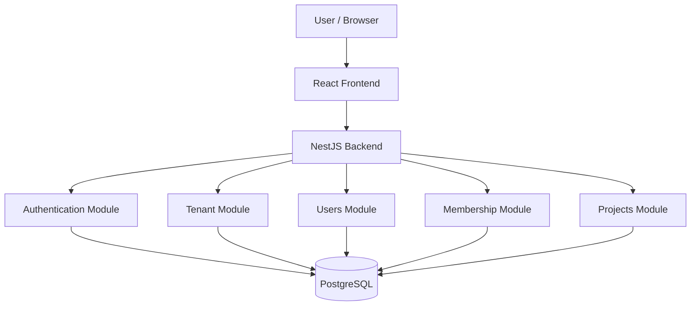
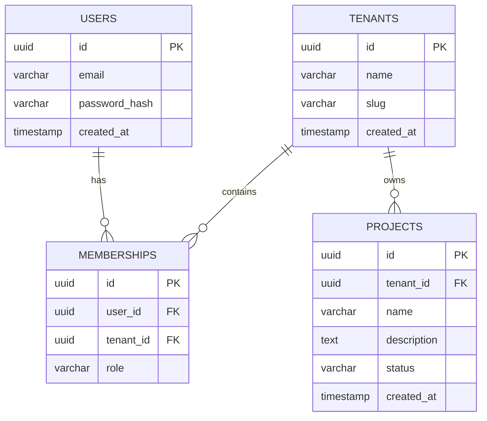

# Multi-Tenant SaaS — System Architecture

**Project:** Multi-Tenant SaaS  
**Architecture Version:** 1.0  
**Status:** Initial Design  
**Last Updated:** 19 November 2026

---

## 1. Introduction

This document describes the high-level architecture of the Multi-Tenant SaaS application.

The objective is to build a scalable, secure, maintainable SaaS platform where multiple organizations (tenants) can use the same application while keeping their data isolated.

The system will initially follow a **Modular Monolith Architecture** using NestJS, React, TypeScript, and PostgreSQL.

The architecture should support future enhancements without introducing unnecessary complexity during the initial development phase.

## 2. Project Objectives

The primary objectives are:

- Support multiple organizations using one application.
- Ensure strict tenant-level data isolation.
- Implement secure authentication and authorization.
- Provide reusable and modular backend components.
- Maintain clear separation of business responsibilities.
- Design database relationships suitable for a multi-tenant system.
- Support future scalability and maintainability.
- Establish automated testing and migration practices.

## 3. Technology Stack

| Layer                   | Technology     |
| ----------------------- | -------------- |
| Frontend                | React          |
| Frontend Language       | TypeScript     |
| Frontend Build Tool     | Vite           |
| Backend                 | NestJS         |
| Backend Language        | TypeScript     |
| Database                | PostgreSQL     |
| ORM                     | TypeORM        |
| Package Manager         | pnpm           |
| Database Infrastructure | Docker Compose |
| Secret Management       | Doppler        |
| Version Control         | Git and GitHub |

## 4. Architectural Style

### 4.1 Modular Monolith

The backend will follow a Modular Monolith Architecture.

A modular monolith is a single deployable application containing multiple independent business modules.

Each module owns a specific business responsibility and exposes functionality through clearly defined interfaces.

Initial backend modules:

- Auth Module
- Users Module
- Tenants Module
- Memberships Module
- Projects Module
- Common Module

### 4.2 Why Modular Monolith?

Reasons for choosing this architecture:

1. Easier initial development and deployment.
2. Lower infrastructure complexity than microservices.
3. Clear separation of business responsibilities.
4. Easier transaction management.
5. Modules can be independently tested.
6. Supports future extraction into services when justified.

Microservices will not be introduced unless independent deployment, scaling, or organizational requirements justify the additional complexity.

## 5. High-Level System Architecture



The frontend communicates with the backend through REST APIs.

The backend handles authentication, authorization, business logic, validation, tenant context, and database operations.

PostgreSQL stores application data.

## 6. Backend Architecture

### 6.1 Module Responsibilities

| Module      | Responsibility                                   |
| ----------- | ------------------------------------------------ |
| Auth        | Registration, login, JWT authentication          |
| Users       | User profile and account management              |
| Tenants     | Organization creation and management             |
| Memberships | User-to-tenant relationships and roles           |
| Projects    | Tenant-owned project management                  |
| Common      | Shared guards, decorators, filters and utilities |

### 6.2 Backend Folder Structure

```text
backend/
├── src/
│   ├── main.ts
│   ├── app.module.ts
│   │
│   ├── config/
│   │   └── configuration
│   │
│   ├── common/
│   │   ├── decorators/
│   │   ├── guards/
│   │   ├── filters/
│   │   ├── interceptors/
│   │   └── pipes/
│   │
│   ├── database/
│   │   ├── migrations/
│   │   └── database.module.ts
│   │
│   └── modules/
│       ├── auth/
│       ├── users/
│       ├── tenants/
│       ├── memberships/
│       └── projects/
│
├── test/
└── package.json
```

Each business module should generally contain:

```text
projects/
├── dto/
├── entities/
├── projects.controller.ts
├── projects.service.ts
└── projects.module.ts
```

Controllers handle HTTP requests, services contain business logic, and repositories or TypeORM data-access abstractions handle persistence.

Modules should communicate through exported services or explicitly defined interfaces rather than directly accessing another module's internal implementation.

## 7. Frontend Architecture

The frontend will use React with TypeScript and Vite.

Initial structure:

```text
frontend/
├── src/
│   ├── app/
│   ├── components/
│   ├── features/
│   │   ├── auth/
│   │   ├── tenants/
│   │   ├── users/
│   │   └── projects/
│   ├── hooks/
│   ├── layouts/
│   ├── lib/
│   ├── services/
│   ├── types/
│   └── main.tsx
├── public/
└── package.json
```

Responsibilities:

- Components: reusable UI elements.
- Features: business-specific UI functionality.
- Services: API communication.
- Hooks: reusable React logic.
- Layouts: application layouts.
- Types: shared frontend TypeScript types.

The frontend is responsible for presentation and user interaction, not security enforcement.

## 8. Multi-Tenancy Architecture

### 8.1 Tenant Model

A tenant represents an organization using the SaaS platform.

Multiple users can belong to the same tenant.

A user may also belong to multiple tenants.

The relationship between users and tenants will be managed through a membership entity.

### 8.2 Initial Database Entities

| Entity     | Purpose                         |
| ---------- | ------------------------------- |
| User       | Stores user account information |
| Tenant     | Stores organization information |
| Membership | Connects users to tenants       |
| Project    | Stores tenant-owned projects    |

### 8.3 Initial Database Relationships



### 8.4 Tenant Isolation Strategy

The initial implementation will use a shared PostgreSQL database and shared tables.

Tenant-owned records will contain a `tenant_id` column.

Every tenant-owned read, update, and delete operation must be scoped to the authenticated tenant.

Example:

```typescript
const projects = await projectRepository.find({
  where: {
    tenantId: currentTenantId,
  },
});
```

The backend must derive the active tenant from authenticated and authorized context rather than trusting a tenant ID supplied by the frontend.

Additional safeguards:

- Verify active tenant membership.
- Enforce tenant authorization on every relevant request.
- Use tenant-scoped database queries.
- Validate ownership during updates and deletes.
- Add integration tests for cross-tenant access.
- Consider composite foreign keys and PostgreSQL Row-Level Security as additional defense-in-depth measures.

## 9. Authentication and Authorization

### 9.1 Authentication

Authentication will initially use:

- Email and password registration.
- Secure password hashing.
- Login endpoint.
- JWT-based authentication.
- Protected API routes.

### 9.2 Authorization

Authorization determines what an authenticated user is allowed to do.

Initial membership roles:

- OWNER
- ADMIN
- MEMBER

Permissions will be checked against the user's membership in the active tenant.

Authentication and tenant authorization are separate responsibilities.

A valid JWT does not automatically grant access to every tenant.

## 10. Database Architecture

PostgreSQL will be the primary relational database.

TypeORM will manage entity mapping, repositories, and migrations.

Database design principles:

- Use UUID primary keys.
- Define explicit foreign-key relationships.
- Add indexes for frequently queried columns.
- Use database constraints to protect data integrity.
- Use transactions for operations involving multiple related records.
- Keep schema changes version-controlled through migrations.
- Avoid automatic schema synchronization in production.

Initial indexes to evaluate:

- Unique index on normalized user email, according to the chosen account model.
- Unique index on tenant slug.
- Composite index on membership `(tenant_id, user_id)`.
- Index on project `(tenant_id, created_at)`.

## 11. API Architecture

The backend will expose REST APIs.

Initial endpoint examples:

| Method | Endpoint                       | Purpose              |
| ------ | ------------------------------ | -------------------- |
| POST   | /auth/register                 | Register account     |
| POST   | /auth/login                    | Authenticate user    |
| GET    | /users/me                      | Get current user     |
| POST   | /tenants                       | Create tenant        |
| GET    | /tenants                       | List user's tenants  |
| POST   | /tenants/:tenantId/memberships | Add a member         |
| GET    | /projects                      | List tenant projects |
| POST   | /projects                      | Create project       |
| PATCH  | /projects/:id                  | Update project       |
| DELETE | /projects/:id                  | Delete project       |

API requests will use DTO validation and consistent error responses.

Pagination and filtering will be introduced where collection endpoints require them.

## 12. Environment and Infrastructure Architecture

### 12.1 Local Development

Docker Compose will run PostgreSQL locally.

Doppler will manage development environment variables and application secrets.

The application will receive environment variables through Doppler CLI.

NestJS will read configuration using `@nestjs/config` and `ConfigService`, with local `.env` loading disabled when Doppler supplies the environment.

### 12.2 Infrastructure Structure

```text
infrastructure/
└── docker/
    └── compose.yaml
```

### 12.3 Secret Management

Doppler configurations:

- dev: Local development.
- stg: Staging environment.
- prd: Production environment.

Secrets must never be committed to Git.

## 13. Security Principles

The application will follow these security principles:

- Hash passwords using a suitable password-hashing algorithm.
- Validate all incoming requests.
- Protect private routes using authentication guards.
- Enforce role-based and tenant-level authorization.
- Prevent cross-tenant data access.
- Avoid exposing secrets in logs.
- Use parameterized database operations through TypeORM.
- Apply appropriate CORS and security headers.
- Use HTTPS in deployed environments.
- Keep dependencies updated.

## 14. Testing Strategy

The project will include:

### Unit Tests

Test individual services and business rules.

### Integration Tests

Test database interactions, repositories, and module integration.

### End-to-End Tests

Test complete API workflows.

Critical test cases:

- Successful registration and login.
- Unauthorized requests are rejected.
- Tenant membership is verified.
- Tenant A cannot access Tenant B's projects.
- Users cannot modify another tenant's records.
- Invalid DTOs are rejected.
- Database transactions preserve data consistency.

## 15. Scalability Strategy

The initial system will be a modular monolith.

Potential future improvements:

| Area                     | Future Enhancement              |
| ------------------------ | ------------------------------- |
| API performance          | Redis caching                   |
| Background jobs          | BullMQ and Redis                |
| Database performance     | Query optimization and indexing |
| Application scaling      | Multiple backend instances      |
| Observability            | Centralized logs and metrics    |
| Deployment               | CI/CD pipelines                 |
| Distributed architecture | Extract services when justified |

These are future possibilities, not requirements for the initial MVP.

## 16. Architectural Decisions

| Decision               | Choice                     | Reason                                   |
| ---------------------- | -------------------------- | ---------------------------------------- |
| Backend architecture   | Modular Monolith           | Simplicity and clear module boundaries   |
| Frontend               | React + TypeScript         | Component-based UI                       |
| Backend framework      | NestJS                     | Structured Node.js architecture          |
| Database               | PostgreSQL                 | Relational integrity and transactions    |
| ORM                    | TypeORM                    | NestJS integration and migration support |
| Multi-tenancy          | Shared database and tables | Suitable initial complexity              |
| Environment management | Doppler                    | Centralized secret management            |
| Infrastructure         | Docker Compose             | Reproducible local database environment  |
| Package management     | pnpm workspaces            | Monorepo dependency management           |

## 17. Future Architecture Review

This document represents the initial architecture, not a permanent constraint.

Architecture decisions should be revisited when:

- New business requirements emerge.
- Tenant isolation requirements change.
- Performance bottlenecks appear.
- Deployment requirements evolve.
- Modules become difficult to maintain independently.

Significant architectural changes should be documented as Architecture Decision Records (ADRs) under:

```text
docs/adr/
```

---
